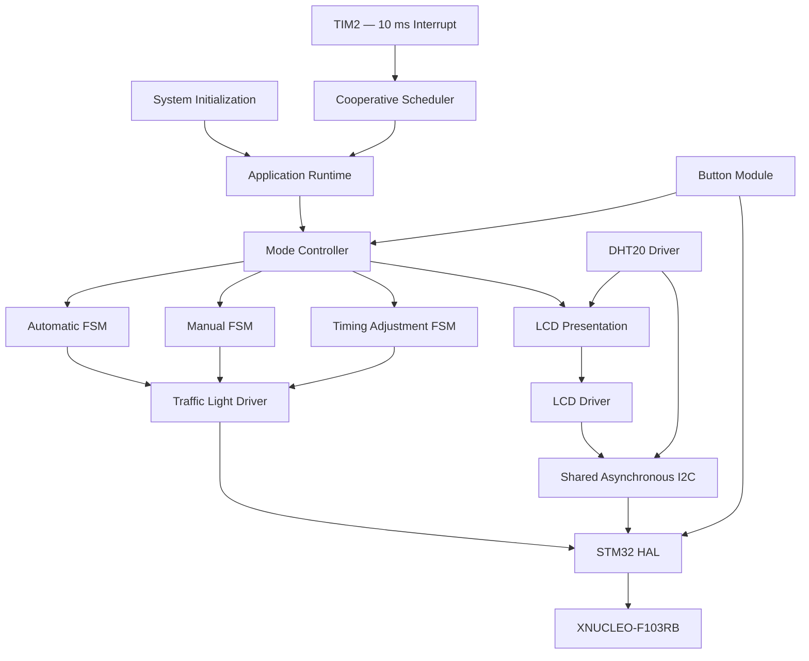
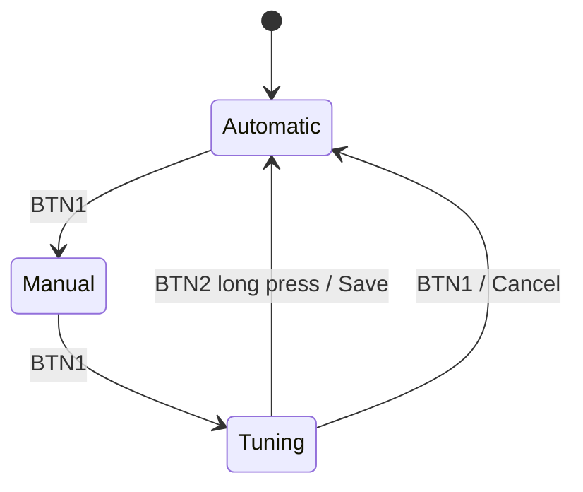
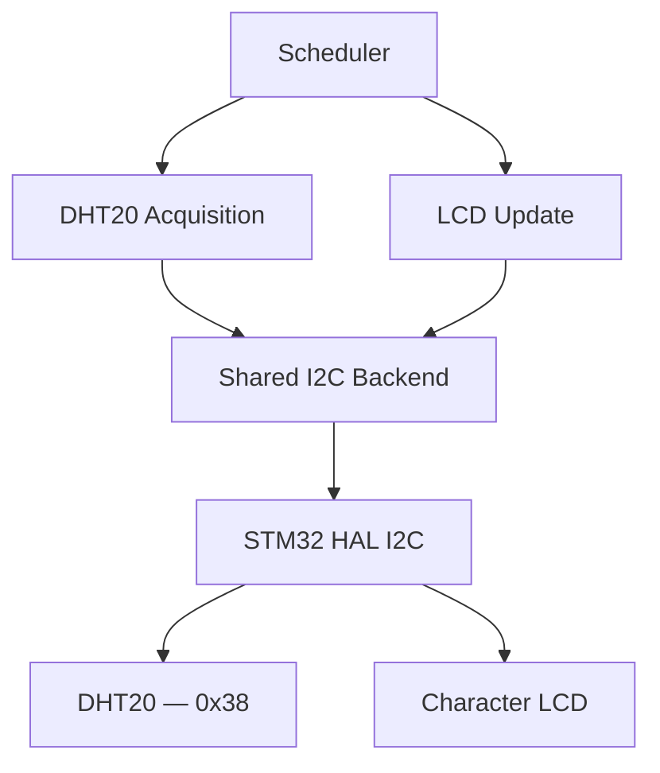

# Two-Road Traffic Light System

A traffic light control system for a two-road intersection, implemented in C on the STM32F103RB microcontroller. The system combines cooperative task scheduling, finite-state machines, configurable signal timing, and environmental monitoring through a shared asynchronous I2C interface.

The repository includes application firmware, peripheral drivers, hardware configuration, host-side tests, build configurations, and technical documentation.

Developed for CO3009 — Microprocessors and Microcontrollers at Ho Chi Minh City University of Technology (HCMUT), VNU-HCM.

---

## Project Overview

The project implements a traffic light controller with three operating modes: Automatic, Manual, and Timing Adjustment. A cooperative scheduler coordinates application tasks and peripheral operations using a 10 ms hardware timer interrupt.

The system separates application logic from hardware access, allowing individual modules and operating scenarios to be tested independently of the physical board.

| Function | Description |
|---|---|
| Automatic control | Executes the traffic light sequence using configured signal durations |
| Manual control | Allows the operator to advance traffic phases using push buttons |
| Timing adjustment | Supports independent adjustment of Red, Green, and Amber durations |
| Environmental monitoring | Acquires temperature and humidity from a DHT20 sensor |
| LCD interface | Displays operating modes, timing parameters, and environmental data |
| Task scheduling | Supports periodic and one-shot tasks with O(1) tick processing |

The system is designed as an academic embedded systems prototype rather than a certified traffic control device.

---

## System Architecture

The firmware is organized into application, scheduling, peripheral, and hardware abstraction layers.



The application state machines operate through module interfaces rather than accessing hardware directly. Peripheral communication is separated from traffic control so that LCD or sensor failures do not prevent the traffic light state machines from continuing operation.

See [`docs/architecture.md`](docs/architecture.md) for the detailed firmware architecture.

---

## System Components

| Component | Interface | Purpose |
|---|---|---|
| XNUCLEO-F103RB | ARM Cortex-M3 | Main processing and system control |
| Traffic light module 1 | GPIO | Controls the signal state of Road 1 |
| Traffic light module 2 | GPIO | Controls the signal state of Road 2 |
| Push button modules | GPIO | Mode selection, manual control, and timing adjustment |
| DHT20 | I2C | Temperature and humidity acquisition |
| Character LCD | I2C | Operating information and environmental display |
| TIM2 | Hardware interrupt | Generates the scheduler time base |
| ST-LINK | SWD | Firmware programming and debugging |

### Hardware Connections

| Device | Board Interface |
|---|---|
| Traffic light module 1 | D3, D4 |
| Traffic light module 2 | D5, D6 |
| Button module 1 | D7, D8 |
| Button module 2 | D9, D10 |
| USER button | PC13 |
| DHT20 | I2C1 |
| LCD | I2C1 |
| Diagnostic LEDs | PA5, PC9 |

The traffic light decoder codes, button polarity, and LCD configuration are board-dependent. These parameters must be verified before enabling the corresponding hardware interfaces.

The calibration procedure is documented in [`docs/board-demo-checklist.md`](docs/board-demo-checklist.md).

---

## Repository Structure

```text
CO3009-Traffic-Light-System/
├── Core/
│   ├── Inc/                     # Module interfaces and configuration
│   └── Src/                     # Application, scheduler, FSMs, and drivers
├── firmware/
│   └── STM32F103RBTx_FLASH.ld    # Target linker script
├── tests/                       # Host-side unit and integration tests
│   └── fixtures/                # Test-specific hardware configurations
├── docs/
│   ├── architecture.md
│   ├── board-demo-checklist.md
│   └── pre-board-validation.md
├── CMakeLists.txt
├── Project_Traffic_Light_System.ioc
├── .gitignore
└── README.md
```

Build outputs are generated locally and are not required for source-level development.

---

## Firmware Overview

### 1. Application Runtime

The application runtime initializes system services and registers the tasks required for traffic control, button processing, software timing, environmental sensing, and LCD updates.

Main implementation:

```text
Core/Src/main.c
Core/Src/app_runtime.c
```

Hardware initialization and interrupt handling are separated from application-level operation.

### 2. Cooperative Scheduler

The scheduler maintains a task queue ordered by relative execution delay. The timer interrupt processes only the first task in the queue, keeping `SCH_Update()` independent of the number of registered tasks.

| Function | Responsibility |
|---|---|
| `SCH_Init()` | Initializes scheduler resources |
| `SCH_Add_Task()` | Registers periodic or one-shot tasks |
| `SCH_Delete_Task()` | Removes a registered task |
| `SCH_Update()` | Processes the scheduler tick in O(1) time |
| `SCH_Dispatch_Tasks()` | Executes ready tasks and handles rescheduling |

The scheduler uses a 10 ms time base generated by TIM2. Periodic task scheduling and software timer accounting accommodate elapsed ticks when dispatch is delayed.

Main implementation:

```text
Core/Src/scheduler.c
Core/Src/software_timer.c
```

### 3. Finite-State Machines

The application contains three operating state machines and a mode controller.

| Module | Responsibility |
|---|---|
| `fsm_automatic.c` | Automatic traffic phase progression |
| `fsm_manual.c` | Operator-controlled traffic phase progression |
| `fsm_tuning.c` | Signal duration adjustment and validation |
| `fsm_mode.c` | Mode transitions and application coordination |

The mode controller manages transitions, timer ownership, pending button events, and traffic signal states.

### 4. Peripheral Drivers

| Module | Responsibility |
|---|---|
| `button.c` | Button sampling, debouncing, and event detection |
| `traffic_light.c` | Traffic signal control and GPIO abstraction |
| `dht20.c` | Sensor acquisition and measurement management |
| `dht20_protocol.c` | Sensor data decoding and CRC validation |
| `lcd.c` | LCD operation and buffered updates |
| `lcd_format.c` | Display text formatting |
| `lcd_presentation.c` | Application data presentation |
| `lcd_display.c` | LCD update coordination |
| `lcd_pcf8574.c` | HD44780-compatible LCD backpack interface |
| `i2c_stm32.c` | Shared asynchronous STM32 I2C backend |

The I2C backend manages transaction ownership, completion, timeout handling, and error recovery for the LCD and DHT20.

---

## Operating Modes

### 1. Automatic Mode

Automatic mode controls both roads according to the configured signal durations.

The default traffic sequence is:

```text
Road 1 RED    / Road 2 GREEN
              ↓
Road 1 RED    / Road 2 AMBER
              ↓
Road 1 GREEN  / Road 2 RED
              ↓
Road 1 AMBER  / Road 2 RED
              ↓
         Repeat cycle
```

Default signal durations:

| Signal | Duration |
|---|---:|
| Red | 5 s |
| Green | 3 s |
| Amber | 2 s |

### 2. Manual Mode

Manual mode allows the operator to advance traffic phases using push buttons.

When entering Manual mode, the controller retains the applied traffic phase. Subsequent button events advance the signal sequence while maintaining valid combinations for both roads.

### 3. Timing Adjustment Mode

Timing Adjustment mode allows the operator to select and modify individual signal durations.

| Parameter | Default | Minimum | Maximum |
|---|---:|---:|---:|
| Red | 5 s | 2 s | 40 s |
| Green | 3 s | 1 s | 30 s |
| Amber | 2 s | 1 s | 10 s |

Adjustment step: 1 second.

The current timing configuration must satisfy:

```text
Red duration >= Green duration + Amber duration
```

Changes are maintained as a temporary configuration until confirmed. Saving applies the validated durations to Automatic mode, while cancellation discards uncommitted changes.

Both roads are set to Red during Timing Adjustment mode.

### Mode Switching



### Button Mapping

| Button | Automatic | Manual | Timing Adjustment |
|---|---|---|---|
| BTN1 | Enter Manual | Enter Tuning | Cancel and return |
| BTN2 | — | Advance phase | Select parameter / Hold to save |
| BTN3 | — | — | Increase duration |
| BTN4 | — | — | Decrease duration |

The table reflects the current application implementation. Final mappings remain subject to physical board verification and confirmation against the course specification.

---

## Communication and Peripheral Workflow

The LCD and DHT20 share the same I2C peripheral.



| Operation | Implementation |
|---|---|
| Sensor acquisition | Periodic measurement and data retrieval |
| Measurement validation | Status checks and CRC verification |
| LCD updates | Buffered display operations |
| Bus arbitration | Exclusive transaction ownership |
| Error handling | Timeout, cancellation, and recovery |

Application tasks continue to execute while peripheral transactions are in progress. Environmental monitoring and display operations do not control the execution of traffic phase transitions.

---

## Build and Flash

### 1. Development Requirements

| Tool | Purpose |
|---|---|
| STM32CubeF1 SDK | HAL and CMSIS dependencies |
| ARM GNU Toolchain | Cortex-M3 compilation and linking |
| CMake | Build configuration |
| Ninja | Firmware build execution |
| STM32CubeProgrammer | Firmware programming |
| GCC | Host-side testing |
| PowerShell | Build and test commands on Windows |

The STM32CubeMX configuration is included in:

```text
Project_Traffic_Light_System.ioc
```

Target configuration:

```text
MCU:        STM32F103RB
Core:       ARM Cortex-M3
Flash:      128 KiB
SRAM:       20 KiB
Debug:      Serial Wire
Scheduler:  TIM2, 10 ms tick
```

### 2. Clone the Repository

```bash
git clone https://github.com/VinhTechiee/CO3009-Traffic-Light-System.git
cd CO3009-Traffic-Light-System
```

Use the appropriate development or release branch before building.

### 3. Build the Application

```powershell
cmake -S . -B build/firmware -G Ninja -DCMAKE_BUILD_TYPE=Release

cmake --build build/firmware --clean-first
```

Generated files:

```text
build/firmware/co3009.elf
build/firmware/co3009.hex
build/firmware/co3009.bin
build/firmware/co3009.map
```

The default application build does not enable unverified board-specific traffic outputs, button settings, or LCD hardware settings.

A measured board profile is required for physical operation.

### 4. Build the Diagnostic Firmware

```powershell
cmake -S . -B build/diagnostic -G Ninja -DCMAKE_BUILD_TYPE=Release -DCO3009_BOARD_DIAGNOSTIC=ON

cmake --build build/diagnostic --clean-first
```

The diagnostic firmware supports:

- Button polarity inspection.
- I2C address scanning.
- Scheduler tick measurement.
- One-shot task verification.
- Initial board configuration checks.

Generated diagnostic files:

```text
build/diagnostic/co3009-board-diagnostic.elf
build/diagnostic/co3009-board-diagnostic.hex
```

### 5. Configure the Board Profile

Determine the actual hardware configuration using the diagnostic firmware and the board calibration procedure.

The profile must specify:

- Traffic light decoder truth tables.
- Button active-low mask.
- LCD controller and I2C address.
- LCD dimensions and backpack pin configuration.

Build the application with the measured profile:

```powershell
$profile = (Resolve-Path .\measured-board-profile.h).Path

cmake -S . -B build/board-acceptance -G Ninja -DCMAKE_BUILD_TYPE=Release -DCO3009_BOARD_DIAGNOSTIC=OFF "-DCO3009_PROFILE_HEADER=$profile"

cmake --build build/board-acceptance --clean-first
```

The synthetic hardware profiles under `tests/fixtures/` are intended for software validation only and must not be used for physical deployment.

### 6. Flash the Firmware

Connect the board through ST-LINK and select the SWD interface in STM32CubeProgrammer.

Program and verify:

```text
build/board-acceptance/co3009.hex
```

Reset the board after successful programming.

Complete the checks in [`docs/board-demo-checklist.md`](docs/board-demo-checklist.md) before proceeding with the system demonstration.

---

## Testing and Validation

Host-side tests cover individual modules and integrated application scenarios using simulated hardware interfaces.

Run the test suite on Windows:

```powershell
powershell.exe -NoProfile -ExecutionPolicy Bypass -File tests/run-c-host-tests.ps1
```

Run sanitizer-enabled validation with the supported WSL environment:

```powershell
powershell.exe -NoProfile -ExecutionPolicy Bypass -File tests/run-c-host-tests.ps1 -WslSanitizers
```

### Test Coverage

| Area | Validation |
|---|---|
| Scheduler | Periodic tasks, one-shot tasks, insertion, deletion, and timing |
| Software timer | Expiration, cancellation, and elapsed tick accounting |
| Button processing | Debouncing, press events, and held-button behavior |
| Traffic control | Phase progression and signal safety assertions |
| Mode switching | Entry, exit, and transitions between operating modes |
| Timing adjustment | Parameter limits, validation, saving, and cancellation |
| DHT20 | Protocol decoding, CRC, timeout, and recovery |
| LCD | Formatting, initialization, buffered updates, and recovery |
| Shared I2C | Transaction ownership, arbitration, and error handling |
| Application runtime | Integrated operation and peripheral failure scenarios |

### Pre-board Validation Results

| Verification | Result |
|---|---|
| Host test configurations | 14/14 passed |
| Strict GCC compilation | Passed |
| AddressSanitizer / UndefinedBehaviorSanitizer | Passed |
| Integrated simulation | One hour |
| Dual-green safety assertions | Passed in simulation |
| STM32F103RB application build | Passed |
| Diagnostic firmware build | Passed |
| Synthetic-profile build | Passed |
| Physical board acceptance | Pending |

The integrated simulation checks traffic signal safety after mocked GPIO operations and verifies continued traffic control during peripheral failure scenarios.

These results establish software-level behavior and firmware build compatibility. They do not establish electrical correctness or physical board operation.

### Firmware Resource Usage

Application build:

| Resource | Usage | Capacity | Utilization |
|---|---:|---:|---:|
| Flash | 38,088 B | 128 KiB | 29.06% |
| SRAM | 2,792 B | 20 KiB | 13.63% |

The reported SRAM allocation includes a 1 KiB stack reserve.

Build commands, source revisions, artifact hashes, and detailed validation results are recorded in [`docs/pre-board-validation.md`](docs/pre-board-validation.md).

---

## Development Summary

| Phase | Scope | Outcome |
|---|---|---|
| Phase 1 | System architecture and hardware configuration | Defined module boundaries and hardware interfaces |
| Phase 2 | Scheduler and application FSMs | Implemented task scheduling and traffic control |
| Phase 3 | Supporting peripheral modules | Implemented buttons, LCD, DHT20, and timing adjustment |
| Phase 4 | System integration | Combined application runtime, peripheral drivers, and target firmware |
| Phase 5 | Pre-board validation | Executed host tests and firmware builds |
| Phase 6 | Hardware acceptance | Pending physical board verification |

---

## Documentation Guide

| Document | Purpose |
|---|---|
| [`docs/architecture.md`](docs/architecture.md) | Firmware architecture and module responsibilities |
| [`docs/board-demo-checklist.md`](docs/board-demo-checklist.md) | Hardware calibration, flashing, and acceptance procedure |
| [`docs/pre-board-validation.md`](docs/pre-board-validation.md) | Software verification and firmware build evidence |

---

## Team Contributions

| Member | Responsibilities |
|---|---|
| Nguyen Trung Hau | Cooperative scheduler, software timers, and Automatic FSM |
| Nguyen Le Hoang Nam | Hardware configuration, button processing, traffic light control, and Manual FSM |
| Le Hien Vinh — Team Leader | LCD, DHT20, Timing Adjustment FSM, mode switching, and system integration |

Individual development contributions are recorded in the repository commit history.

---

## Current Limitations

| Limitation | Description |
|---|---|
| Hardware calibration | Traffic decoder codes and button polarity require physical measurements |
| LCD compatibility | The PCF8574 adapter requires confirmation of the actual LCD hardware configuration |
| Physical timing | Signal durations and interrupt timing require board-level measurement |
| Physical safety verification | Signal transitions must be checked on the connected traffic light modules |
| Deployment scope | The system is intended for academic demonstration, not public-road traffic control |

---

## Course Information

| Item | Details |
|---|---|
| Course | CO3009 — Microprocessors and Microcontrollers |
| Institution | Ho Chi Minh City University of Technology |
| Faculty | Computer Science and Engineering |
| Platform | XNUCLEO-F103RB |
| Academic Year | 2026–2027 |

The repository documents the design, implementation, integration, and validation of an STM32-based embedded traffic light control system.
